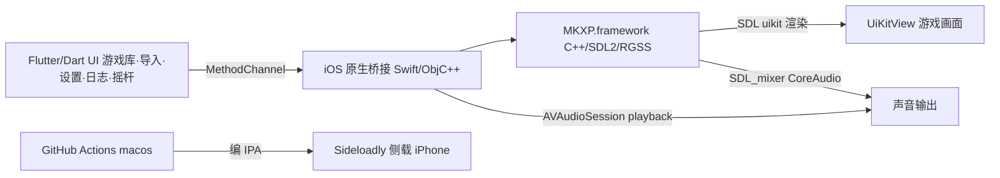

## 产品概述

一个运行在 iPhone 上的自用 RPG Maker XP 游戏启动器，目标是流畅运行用户自己的 Pokémon Essentials 21.1（基于 RGSS1）游戏。App 用 Flutter 做界面外壳，内嵌 MKXP-Z 引擎（C++/SDL2）负责实际运行游戏；无 Mac 环境，依赖 GitHub Actions 云端 macOS 编译出未签名 IPA，再用 Sideloadly + 免费 Apple ID 侧载到真机自用，每 7 天重签。

## 核心功能

- 全屏运行 Essentials 21.1 游戏，包含画面渲染与声音播放（含逐帧精灵动画）。
- 屏幕虚拟控制（**以用户提供的游戏内截图为 UI 蓝本**）：左侧**圆环形方向摇杆**（半透明深色圆环、内含四向箭头、支持 8 向倾斜取主方向，映射 RGSS 方向键）；右侧 **2×2 圆形玻璃拟态动作键**（C 确定 / X 取消 / Z 特殊 / 菜单，图标可后续在设置页重映射）；右上角**悬浮"⋯"菜单按钮**用于收起/呼出控件与打开日志。全部触摸经 MethodChannel 发 RGSS 键码。
- 游戏导入与解压：库页右上角"+"入口，从文件选择或 iTunes 文件共享导入 .zip，自动解压到 App 沙盒游戏目录。
- 游戏库（**以用户提供的"我的游戏"截图为 UI 蓝本**）：搜索栏 + 排序/筛选行 + 游戏列表（圆形图标、游戏名、"RPG Maker XP"引擎副标题、最近游玩时长/时间、右箭头），扫描含 Game.ini 的目录。
- 日志页：读取 MKXP 写入的 mkxp.log，作为无 Mac 环境下的调试代偿。
- 设置页（**以用户提供的"设置"截图为 UI 蓝本**）：iOS 风格分组卡片——通用（语言、外观）、游戏（保持屏幕常亮、固定横屏游戏、控制器振动、默认游戏配置、虚拟键盘预设、实体手柄）。
- 方向约定：**菜单页（库/设置/日志/导入）竖屏，游戏运行页横屏**；"固定横屏游戏"开关控制进游戏是否锁定横屏。

## 技术栈

- UI 框架：Flutter 3.x（Dart），iOS 端通过 `UiKitView`(PlatformView) 嵌入原生游戏视图。
- 游戏引擎：MKXP-Z（C++/SDL2 的 RGSS 重实现），Ruby 绑定使用 **MRI**（完整 Ruby），以兼容 Essentials 大量自定义脚本。
- 原生桥接：Swift + Objective-C++，通过 `MethodChannel` 与 Dart 通信。
- 音频：SDL_mixer（CoreAudio），编入 OGG/Vorbis 与 WAV 解码；原生侧配置 `AVAudioSession` 为 `.playback` 绕过静音拨片。
- 导入解压：Dart `file_picker` + `archive` 包。
- 构建：GitHub Actions `macos-latest` runner（iOS 工具链用 ios-cmake），`flutter build ios --no-codesign` + 打包未签名 IPA。
- 安装：Sideloadly + 免费 Apple ID 侧载，7 天重签，仅自用不上架。

## 实现方案

总体策略：Flutter 仅承担"外壳"（游戏库、导入、设置、虚拟摇杆、日志），真实运行由 MKXP 引擎在原生 `UIView` 中完成，SDL 把 RGSS 画面渲染进该视图，Flutter 用 `UiKitView` 把它显示出来。控制与输入走 `MethodChannel`。

关键决策：

1. **MRI 而非 mruby**：Essentials 自定义 Ruby 脚本极多，mruby 容易崩溃，必须用完整 MRI 运行时（代价是 iOS framework 更大、交叉编译更重，但兼容优先）。
2. **MVP 先行（M0 先验证流水线）**：无 Mac 下最大风险是"编译/侧载链路是否通"，故先交付一个最小 Flutter 壳子（全屏 UiKitView + 写日志），让用户第一次 push 就能侧载到一个能跑的 App，确认 push→CI→IPA→Sideloadly→真机 全链路，再接引擎。
3. **MKXP 精确嵌入 API 标记待核实**：MKXP 启动入口、SDL 如何绑定 Flutter 提供的 UIView，需读 mkxp-z 源码在确定时核实；脚本与桥接先按合理假设编写，首轮 CI/真机日志驱动迭代。
4. **日志代偿调试**：无 Xcode 控制台，强制 MKXP 把 stdout/stderr 与 RGSS 报错写入 `Documents/mkxp.log`，Flutter 日志页读取。

性能与可靠性：游戏视图全屏、Flutter 仅叠加薄层摇杆/按键，避免 PlatformView 叠加拖慢帧率；MKXP.framework 在 CI 用 cache 缓存，避免每次重编浪费 macOS 额度。菜单页与游戏页分屏向（竖/横），避免频繁旋转带来的 PlatformView 重建开销。

## 实现注意

- 云端 macOS 编译是唯一出包路径；本机 Windows 只写代码与脚本文本，不能跑 iOS 模拟器。
- `flutter build ios` 必须在 CI 执行；本地仅 `flutter analyze`/`flutter test` 与撰写原生源码文本。
- IPA 打未签名包（Payload/Runner.app → zip），由 Sideloadly 在 Windows 侧负责重签安装。
- 音频需在原生侧激活 `AVAudioSession(.playback)`，否则静音拨片会掐声——列为 M1 必做项。
- 横竖屏切换在原生侧控制（MkxpPlugin 暴露 `setOrientation`），Flutter 侧菜单页锁竖屏、游戏页按设置锁横屏或自适应。

## 架构设计



## 目录结构

全新项目（greenfield），工作区 c:/Users/Lenovo/CodeBuddy/20260908220535。拟创建文件：

```
rpgxp_flutter/
├── lib/
│   ├── main.dart                 # [NEW] App 入口，底部 Tab(游戏/设置) + 路由到游戏视图/日志
│   ├── services/mkxp.dart        # [NEW] MethodChannel 封装：listGames/importZip/launch/key/readLog/setOrientation
│   ├── models/game_entry.dart    # [NEW] 游戏条目(名称/图标/引擎/最近游玩时长)
│   ├── widgets/game_view.dart    # [NEW] UiKitView 承载 MKXP 游戏画面
│   ├── widgets/touch_pad.dart    # [NEW] 圆环方向摇杆 + 2×2 圆形动作键(C/X/Z/菜单) + 悬浮菜单按钮，发 RGSS 键码
│   └── screens/
│       ├── library.dart          # [NEW] "我的游戏"：搜索栏+排序筛选行+游戏列表(圆形图标/名称/引擎/最近游玩)
│       ├── import.dart           # [NEW] file_picker 选 zip + archive 解压(库页"+"进入)
│       ├── settings.dart         # [NEW] iOS 分组卡片：通用(语言/外观)+游戏(常亮/横屏/振动/配置/键盘预设/实体手柄)
│       └── log_view.dart         # [NEW] 读取并显示 Documents/mkxp.log
├── ios/Runner/
│   ├── MkxpPlugin.swift          # [NEW] 注册 PlatformView 工厂 + MethodChannel(含 setOrientation/振动)
│   ├── MkxpPlatformView.swift    # [NEW] 创建 SDL 视图、启动 MKXP、挂 UIView
│   ├── MkxpBridge.h              # [NEW] ObjC++ 桥接头，暴露 mkxp_run(gamePath, view)
│   ├── MkxpBridge.mm             # [NEW] 调用 MKXP 入口并绑定 UIView
│   └── mkxp/MKXP.framework        # [NEW] M1 由 build_mkxp_ios.sh 产出
├── scripts/
│   └── build_mkxp_ios.sh         # [NEW] MKXP-Z iOS 交叉编译（MRI+SDL2+SDL_mixer+OGG/WAV），最高风险
├── .github/workflows/
│   └── ios.yml                   # [NEW] 云构建主流程：编 MKXP→flutter build→打 IPA→上传 Artifact
└── README.md                     # [NEW] Windows 开发→推 GitHub→下 IPA→Sideloadly 侧载完整步骤
```

## 关键代码结构

```
// lib/services/mkxp.dart  MethodChannel 接口（签名级）
const _ch = MethodChannel('com.yourapp.mkxp');
Future<List<GameEntry>> listGames();          // 名称/图标/引擎/最近游玩
Future<bool> importGameZip(String path);
Future<void> launchGame(String id);
Future<void> sendKey(int rgssKey, bool down); // 虚拟摇杆/动作键 → RGSS 键码
Future<void> setOrientation(bool landscape);  // 菜单竖屏 / 游戏横屏
Future<void> haptic();                        // 控制器振动(设置开关)
Future<String> readLog();
```

```swift
// ios/Runner/MkxpPlatformView.swift（接口级示意）
class MkxpPlatformView: NSObject, FlutterPlatformView {
  func view() -> UIView            // 返回承载 SDL 渲染的 UIView
  // 构造时调用 MkxpBridge.start(gamePath, into: view)
}
```

## 设计风格

面向游戏运行的沉浸式移动界面，**三张用户截图为 UI 蓝本**：

- **游戏运行页**（截图1）：游戏画面 4:3 居中、等比缩放、letterbox 黑边；左侧**圆环形方向摇杆**（半透明深色圆环、内嵌四向三角箭头、中心小圆点指示倾斜方向）；右侧 **2×2 圆形动作键**（半透明磨砂、细白描边、柔光、按下微缩放高亮）；右上角小悬浮"⋯"圆钮收起/呼出控件。
- **游戏库页**（截图2"我的游戏"）：纯黑背景，顶部大号加粗标题"我的游戏"；下方圆角深灰搜索栏（放大镜+占位"搜索游戏"）；筛选/排序行（筛选图标、排序图标、"最近游玩"、右侧游戏计数"X 个游戏"）；游戏列表项=左侧圆形图标 + 游戏名（加粗白字）+ 引擎副标题（灰字"RPG Maker XP"）+ 最近游玩时长/时间（带时钟图标）+ 右侧箭头；右上角蓝色"+"导入按钮；底部双 Tab（游戏🎮/设置⚙，选中态高亮蓝色）；右上角可显示 FPS 角标（如"60"，读取 MKXP 帧率，可选）。
- **设置页**（截图3"设置"）：纯黑背景 + 大号加粗标题"设置"；iOS 风格深灰圆角分组卡片——「通用」组：语言（地球图标，右侧"简体中文 >"）、外观（月亮图标，右侧"自动 ⇅"）；「游戏」组：保持屏幕常亮（太阳图标，绿色开关）、固定横屏游戏（旋转图标，开关）、控制器振动（手机振动图标，开关）、默认游戏配置（滑杆图标，>）、虚拟键盘预设（键盘图标，>）、实体手柄（手柄图标，>，后续可选实现）。蓝色图标 + 绿色 iOS 开关。

整体深色（接近纯黑）背景突出游戏画面；卡片/控件用玻璃拟态与柔和微动效；中文字体 PingFang SC，标题 22px/600，正文 14px/400。布局遵循 iPhone 安全区。

## 页面规划

- 游戏库页（竖屏）：标题"我的游戏" + 搜索栏 + 排序/筛选行 + 游戏列表（圆形图标/名称/引擎副标题/最近游玩时长）+ 右上"+"导入 + 底部 Tab（游戏/设置）。
- 游戏运行页（横屏）：全屏黑底，4:3 画面居中 letterbox；左下圆环摇杆、右下 2×2 动作键（C/X/Z/菜单）、右上悬浮"⋯"，可整体收起/呼出。
- 导入页（竖屏）：文件选择按钮 + 解压进度，完成后回库。
- 设置页（竖屏）：iOS 分组卡片（通用：语言/外观；游戏：常亮/固定横屏/控制器振动/默认游戏配置/虚拟键盘预设/实体手柄）。
- 日志页：等宽字体滚动显示 mkxp.log，带刷新与清空。

## 交互

- 库页：点列表项进游戏（横屏启动，记录游玩时长到"最近游玩"）；"+"进导入页；搜索框实时过滤；排序默认"最近游玩"。
- 游戏页：左圆环摇杆拖动产生方向向量，超过死区映射主方向键（8 向取主方向），回中松键；右侧动作键按下/抬起发 RGSS 键码按下/释放；右上"⋯"单击切换控件显隐、长按开日志页。
- 设置页：iOS 开关即时生效（常亮→原生 idleTimerDisabled；振动→CoreHaptics；固定横屏→原生 setOrientation）。
- 所有悬浮控件半透明、触摸反馈明显，避免过度遮挡画面。「实体手柄」为后续可选（M3 之后）。