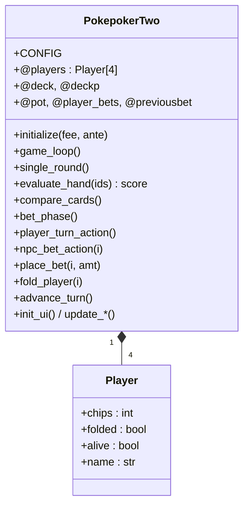

## 用户需求

以原版 `Plugins/PokemonPoker`（7 张德州扑克的"质量范式"参考）为蓝本，把 `Plugins/PokemonPoker 2\main.rb` 重写为干净且逻辑正确的炸金花（3 张）小游戏。

## 产品概览

一个可在 Essentials/MKXP 中通过 `PokepokerTwo.new(初始筹码, 底注)` 调用的炸金花小游戏：1 名玩家 + 3 名 NPC，每轮底注→发牌→下注（跟注/加注/弃牌/全押）→比牌，筹码不足出局，NPC 全灭或玩家破产则结束，终局将玩家筹码回写 `$game_variables[@chipsvariable]`。

## 核心特性（重构目标）

- 修复牌型判定 bug：现行 `compare_cards` 实际使用的 `judge_hand_rank` 只看牌值、不认花色、且只有豹子/顺子/对子/散牌 4 档，导致金花、顺金永不被识别、赢家判定错误。
- 牌型优先级正确：豹子 > 顺金 > 金花 > 顺子 > 对子 > 散牌，含 A-2-3 最小顺、Q-K-A 最大顺，同型按牌值降序 tiebreak。
- 玩家模型具名化：用 `Player` 结构替换 `@players` 裸数组与魔法下标 `[0..3]`。
- 下注逻辑去重：抽取 `place_bet/fold_player/advance_turn` 原语，玩家与 NPC 仅保留"决策"差异。
- 配置集中化：筹码变量号、随机名开关、NPC 筹码范围、底注、加注倍数、UI 坐标、viewport 层级、资源路径、字体名统一进 `CONFIG`。
- 保留现有单文件插件形态、四角 UI 布局、FusionPixel 中文字体与卡牌图片资源观感。

## 技术栈

- 语言/运行时：Ruby（RGSS3，运行于 MKXP / Pokémon Essentials 21.1）。
- 形态：单文件插件（与原版、2 代一致，便于随工程分发），入口 `PokepokerTwo.new(fee, ante_value)`。
- 资源：卡牌图 `Graphics/Pictures/Pokepoker/card1..52`、`backcard`、`pokerbg`、`names`、`chipscounter`；字体 `FusionPixelMonoPatched`。

## 实现思路

参照原版 `handrate(hand1..hand7)` 的核心范式——**把一手牌压缩成"单个可比较整数分数"，比牌即取最大值**——将其适配到 3 张炸金花。原版 7 张逻辑不能直接套（规则不同），但"单分数比较"与"update* UI 方法拆分"是值得复用的结构范式。

### 1. 牌型评估（核心修复，`evaluate_hand`）

返回单整数分数：`score = category*1_000_000 + t1*10_000 + t2*100 + t3`，其中 `t1>=t2>=t3` 为用于 tiebreak 的三张牌值（A=14）：

- 豹子（三同值）：`category=6`，tiebreak=`[v,v,v]`。
- 顺金（同花且顺子）：`category=5`，tiebreak 用顺子高牌（A-2-3 记为高 3；Q-K-A 记为 14）。
- 金花（仅同花）：`category=4`，tiebreak=三值降序。
- 顺子（仅顺子）：`category=3`，同上顺子高牌。
- 对子：`category=2`，tiebreak=`[对子值, 对子值, 单张]`（单张强制置后，避免被高踢脚反超）。
- 散牌：`category=1`，tiebreak=三值降序。
- 235>豹子 特殊规则做成 `CONFIG.special_235_beats_trio` 开关，默认关（标准炸金花）。
- 删除 `get_card_type` 与 `judge_hand_rank`；`compare_cards` 改用 `evaluate_hand` 并对所有未弃牌未出局玩家取 `max`（沿用原版 max-score 即赢思路），tiebreak 自然生效。

### 2. 玩家模型（`Player` 结构）

新增轻量结构 `Player`（或含 `attr_accessor` 的小类），字段 `chips / folded / alive / name`。`@players` 改为 `Player` 数组，全文件消除 `@players[i][0..3]` 魔法下标（结合 2 代与原版共有的该缺陷一并修复）。

### 3. 下注原语与状态机

抽取 `place_bet(idx, amount)`（扣筹码、加底池、累加 `@player_bets[idx]`、更新 UI、识别全押）、`fold_player(idx)`、`advance_turn`。`bet_phase` 维护 `@playersup/@noraise/@previousbet`，`player_turn_action` 与 `npc_bet_action` 仅做"决策"（玩家走菜单、NPC 走 `chip_ratio` 权重 AI），动作统一调原语，修复全押玩家跳过逻辑与"加注后重置无加注计数"边界。

### 4. UI 与回合流程

- `init_ui`/`update_players_ui`/`updatechips`/`updatepot`/`updatefold` 移植现有四角布局与精灵，硬编码坐标/层级替换为 `CONFIG` 常量，保留中文 `set_chinese_font` 与图片引用。
- `game_loop`/`single_round`/`deduct_ante`/`reset_round_state` 去重校验、语义化变量名。

## 实现注意事项

- 仅重写 `main.rb`，不触碰 `meta.txt` 与图片资源；保持 `PokepokerTwo` 类名与 `new(fee, ante)` 签名，避免调用方（地图事件脚本）改动。
- 不修改引擎邻接/脚本系统；纯插件内重构，blast radius 限于本文件。
- 保留 `@chipsvariable` 默认 56、`betscene` 加注倍数 `[2,3,5]`、`@npc_min/max_chips` 等比设定等现有可调参数，归入 `CONFIG`。
- 实现后先跑临时单测脚本验证 `evaluate_hand` 全部牌型与边界，再 `ruby -c` 语法检查，最后游戏内实测。

## 架构设计

单类 `PokepokerTwo`，方法按职责分组（配置/牌局/牌型/下注/UI/工具），状态集中在实例变量。比牌与下注均以"单整数分数 / 统一原语"为核心，消除原 2 代的双份判定与双份下注逻辑。



## 目录结构

```
宝可梦sp4/Plugins/PokemonPoker 2/
└── main.rb   # [MODIFY] 原地重写。单文件 class PokepokerTwo：
              #   - 顶部 CONFIG 常量区（变量号/随机名/NPC筹码区间/底注/加注倍数/UI坐标/viewport层级/资源路径/字体）
              #   - Player 小类（chips/folded/alive/name）
              #   - evaluate_hand(ids) 单整数评分牌型判定（替换 get_card_type + judge_hand_rank）
              #   - 牌局流程 game_loop/single_round/deduct_ante/reset_round_state
              #   - 下注 bet_phase/player_turn_action/npc_bet_action + 原语 place_bet/fold_player/advance_turn
              #   - UI init_ui/update_players_ui/updatechips/updatepot/updatefold/show_player_cards/flip_npc_cards/betscene
              #   - 工具 compare_cards/has_alive_npc?/final_game_over/set_chinese_font/load_card_sprite
              # 保留 meta.txt 与 Graphics/Pictures/Pokepoker/* 资源不动
```

## 关键代码结构

```
# 牌型评估：返回单整数可比较分数
# 分数 = category*1_000_000 + t1*10_000 + t2*100 + t3 （t1>=t2>=t3 为牌值降序，A=14）
# category: 6=豹子 5=顺金 4=金花 3=顺子 2=对子 1=散牌
def evaluate_hand(card_indexes)
  # card_indexes: 1..52；经 @deck 取 [value, suit]
  # 返回整数分数；235>豹子 由 CONFIG.special_235_beats_trio 控制
end

# 玩家模型（替换裸数组）
Player = Struct.new(:chips, :folded, :alive, :name)  # folded/alive 用布尔

# 下注原语（玩家与 NPC 共用）
def place_bet(idx, amount)   # 扣筹码+加底池+累加已下注+更新UI+识别全押
def fold_player(idx)         # 标记弃牌+playersup-1+更新弃牌UI
def advance_turn             # 取下一个 alive && !folded 的玩家，无则结束下注
```